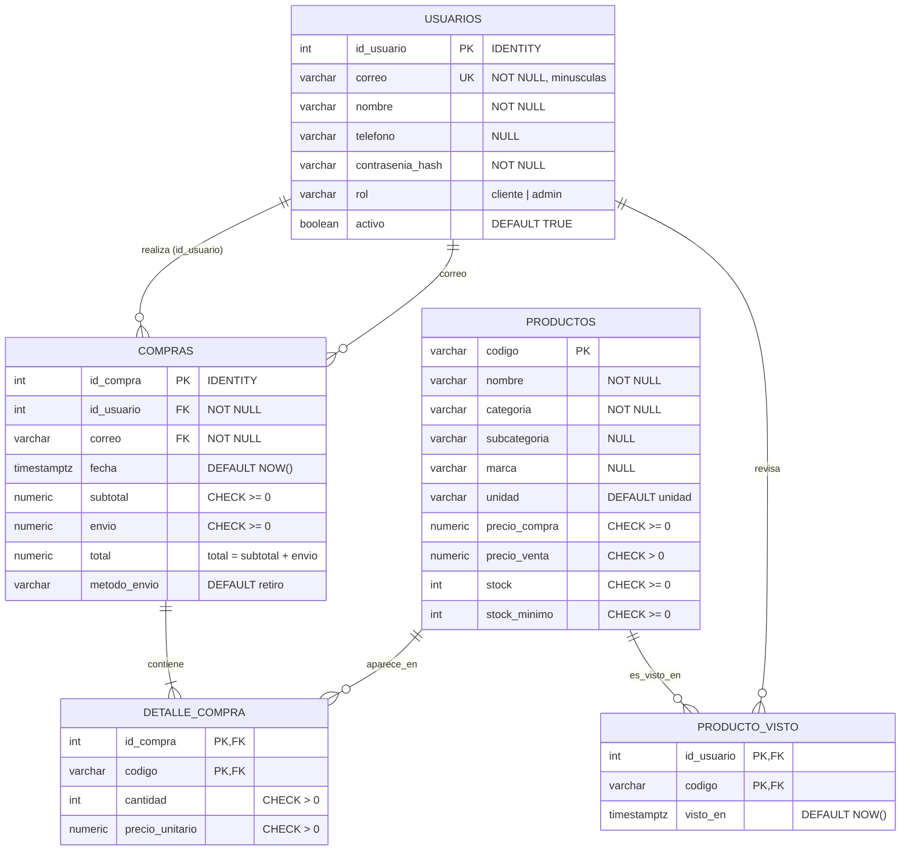
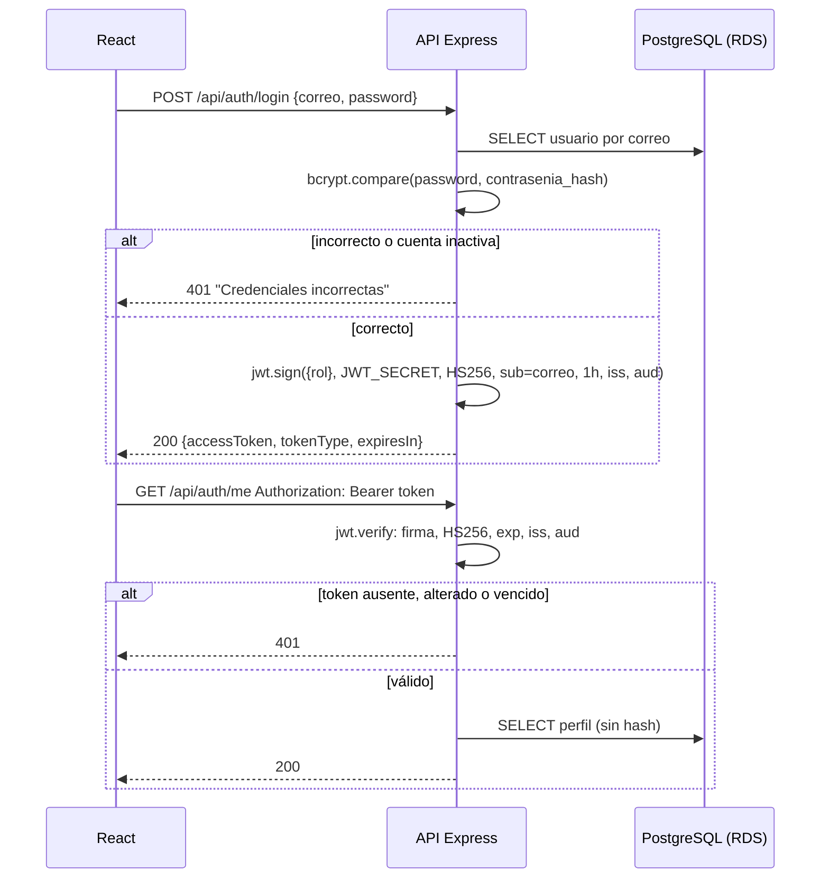

## 1. Identificación y alcance

| | |
| --- | --- |
| **Proyecto** | Backend del proyecto semestral, Evaluación Parcial 3 (avance) |
| **Asignatura / sección** | Desarrollo Fullstack II · Sección 005D |
| **Caso** | Ferretería Los Maestros: venta de productos de construcción y ferretería |
| **Integrantes** | Juan Jara · Matías Pizarro · Isahac Zapata |
| **Frontend (React)** | https://github.com/21Century03/Ferreteria_React.git |

**Problema que resuelve.** El frontend de la Parcial 2 guarda el catálogo en `productos.js` y los cambios en `localStorage`. Cada navegador tiene su propia copia, los datos se pierden al limpiar el almacenamiento y no hay control de integridad. Este backend llevará los datos a una base PostgreSQL real en Amazon RDS.

**Funcionalidades que cubrirá el backend:**

| Bloque | Qué incluye | Situación |
| --- | --- | --- |
| 1. Usuarios, autenticación y roles | Registro, inicio de sesión con JWT, perfil (`/me`), CRUD de usuarios y roles | En construcción |
| 2. Catálogo | CRUD de productos con permisos por rol | Diseñado (tabla creada) |
| 3. Solicitud = Compra/Pedido | Crear, listar, ver el detalle y cambiar el estado. Regla de negocio: una compra no puede superar el stock (409). Cada cliente ve solo lo suyo | Diseñado (tablas creadas) |

## 2. Decisiones técnicas

| Componente | Elección | Justificación |
| --- | --- | --- |
| Lenguaje / framework | **Node.js + Express 5** (módulos ES) | Es el mismo lenguaje del frontend, así que todo el equipo lee ambos lados. Express es liviano y es lo que vimos en clase. La versión 5 envía al manejador de errores los fallos de funciones `async`. |
| Ejecución | **EC2 Ubuntu** | En el laboratorio de RDS comparamos EC2 y Lambda. Elegimos EC2 por tener un servidor siempre encendido y control total del entorno, sin arranques en frío ni límites de conexiones por invocación. Para mantener el proceso activo usaremos **pm2**. |
| Motor de base de datos | **PostgreSQL en Amazon RDS** | Relacional, con PK, FK, UNIQUE, CHECK y transacciones. AWS administra parches y respaldos. La instancia `ferreteria-bd` es **privada**: solo el grupo de seguridad de la EC2 entra al puerto 5432. |
| Acceso a datos | `pg` con **Pool** | El pool reutiliza conexiones en vez de abrir una por solicitud. Las consultas son **parametrizadas** (`$1, $2`), lo que evita la inyección SQL. |
| Variables | `dotenv` | Credenciales y secretos en `.env`, excluido por `.gitignore`. |
| Validación | **zod** | Validar en el servidor los datos de entrada (registro, login). |
| Contraseñas | **bcrypt** | Ver la [sección 7](#7-seguridad). |
| Sesión | **jsonwebtoken** (JWT HS256) | Ver la [sección 7](#7-seguridad). |
| Seguridad HTTP | `helmet`, `cors`, `express-rate-limit` | Cabeceras de seguridad, CORS solo para el origen del frontend (`FRONTEND_URL`) y límite de intentos de login. |
| Documentación | `swagger-ui-express` + `swagger-jsdoc` | Documentación viva en `/api-docs`. |
| Pruebas | `vitest` + `supertest` | Pruebas de endpoints. |
| Desarrollo | `nodemon` | Reinicio automático al guardar (`npm run dev`). |

## 3. Diseño de datos

- **Diagrama entidad-relación (Drive):** https://drive.google.com/drive/folders/14k1awwMiWDrTOaiwSGToN7Wu9MOXmKKS?usp=sharing
- **Carpeta en Drive:** ⟨enlace a la carpeta⟩ · Ruta: `⟨Mi unidad / Fullstack II / Parcial 3 / Diagramas⟩`
- **Acceso:** compartido como "Cualquier persona con el enlace: Lector" (y con el correo del docente).
- **Script de la base:** [`src/bd/schema.sql`](src/bd/schema.sql) · datos iniciales en [`src/bd/seed.sql`](src/bd/seed.sql) (3 productos: HM-001, HE-001, PI-001)

El diagrama corresponde exactamente a `src/bd/schema.sql` :



**Tablas (5):** `usuarios`, `productos`, `compras`, `detalle_compra` y `producto_visto`.

**Relaciones:**

- **usuarios 1–N compras.** Un usuario realiza muchas compras y cada compra pertenece a un solo usuario. `compras` referencia a `usuarios` **dos veces**:
  - por `id_usuario`, con `REFERENCES usuarios(id_usuario) ON DELETE RESTRICT`;
  - por `correo`, con `REFERENCES usuarios(correo) ON UPDATE CASCADE ON DELETE RESTRICT`, y un índice `idx_compras_correo` para buscar compras por correo.

  La segunda FK es redundante (el correo se obtiene con un JOIN por `id_usuario`). Queda anotada para simplificarla.
- **compras 1–N detalle_compra.** Cada compra contiene una o más líneas de detalle.
- **productos 1–N detalle_compra.** Un producto aparece en muchas líneas de detalle. Así se resuelve la relación N–M entre compras y productos, con PK compuesta `(id_compra, codigo)`: un producto no se repite dentro de una compra, se usa `cantidad`.
- **usuarios 1–N producto_visto** y **productos 1–N producto_visto.** Es el historial de productos que revisa cada usuario, con PK compuesta `(id_usuario, codigo)` y la fecha `visto_en`.

**Restricciones relevantes:**

| Tabla | Restricción | Motivo |
| --- | --- | --- |
| `usuarios` | `id_usuario INT GENERATED ALWAYS AS IDENTITY` | La base genera el id; el cliente no lo elige. |
| `usuarios` | `correo` UNIQUE y `CHECK (correo = LOWER(correo))` | Evita cuentas duplicadas del tipo `Ana@x.cl` y `ana@x.cl`. |
| `usuarios` | `contrasenia_hash` NOT NULL | Se guarda el hash bcrypt, nunca la contraseña. |
| `usuarios` | `rol` DEFAULT `'cliente'` y `CHECK (rol IN ('cliente','admin'))` | Solo existen esos dos roles; quien se registra parte como cliente. |
| `usuarios` | `activo BOOLEAN DEFAULT TRUE` | Permite desactivar en vez de borrar. |
| `productos` | `codigo VARCHAR(30)` PK | Código de negocio de la ferretería (ej. `HM-001`). |
| `productos` | `precio_compra NUMERIC(12,2) CHECK (>= 0)` y `precio_venta NUMERIC(12,2) CHECK (> 0)` | No hay costos negativos ni productos gratis. |
| `productos` | `stock` y `stock_minimo` `CHECK (>= 0)` | Aunque falle el backend, la base nunca acepta stock negativo. |
| `productos` | `unidad` DEFAULT `'unidad'` | Valor por defecto si no se indica. |
| `compras` | `subtotal`, `envio`, `total` `NUMERIC(12,2) CHECK (>= 0)` y `CHECK (total = subtotal + envio)` | El total siempre cuadra. |
| `compras` | `fecha TIMESTAMPTZ DEFAULT NOW()` | La fecha la pone la base. |
| `compras` | `metodo_envio VARCHAR(30) DEFAULT 'retiro'` | Pertenece a la compra completa, no a cada línea. |
| `compras` → `usuarios` | `ON DELETE RESTRICT` (en ambas FK) | No se borra un usuario que tiene compras. |
| `detalle_compra` → `compras` | `ON DELETE CASCADE` | Si se borra una compra, se borra su detalle. |
| `detalle_compra` → `productos` | `ON UPDATE CASCADE ON DELETE RESTRICT` | No se borra un producto ya vendido; si cambia su código, el detalle se actualiza solo. |
| `detalle_compra` | `cantidad CHECK (> 0)`, `precio_unitario NUMERIC(12,2) CHECK (> 0)` | Guarda el precio del momento de la compra. |
| `producto_visto` → `usuarios` / `productos` | `ON DELETE CASCADE` (y `ON UPDATE CASCADE` hacia productos) | El historial desaparece junto con el usuario o el producto. |

Además, [`src/bd/usuario.sql`](src/bd/usuario.sql) crea el usuario de base de datos `ferreteria_app` con permisos mínimos (CONNECT, USAGE, SELECT/INSERT/UPDATE/DELETE y uso de secuencias), para que la API no se conecte como `postgres`.

## 4. Organización del backend

```text
src/
  server.js                       arranca el servidor en PORT y 0.0.0.0
  app.js                          middlewares globales (helmet, cors, json), ruta /health y manejo de errores
  config/db.js                    Pool de PostgreSQL con SSL hacia RDS
  routes/authRoutes.js            rutas /register, /login, /me con validación zod y rate limit
  services/auhServices.js         reglas: registro con hash, login con JWT, perfil
  repositories/usuariosRepository.js   consultas SQL de usuarios
  midlewares/auth.js              verifica el JWT (autenticar) y el rol (requerirRol)
  midlewares/validad.js           valida el body con un esquema zod
  midlewares/errores.js           respuesta uniforme de errores (AppError, 409 duplicado, 500)
  utils/appError.js               error con código HTTP
  docs/swagger.js                 configuración de Swagger (por completar)
  bd/                             schema.sql, seed.sql, usuario.sql, crearAdmin.js
```

| Capa | Responsabilidad |
| --- | --- |
| Rutas | Definen la URL y encadenan validación, autenticación y rol antes del controlador. |
| Controladores | Reciben la solicitud y responden con el código HTTP. En el avance están dentro de las rutas; se separarán en `controllers/`. |
| Servicios | Reglas de negocio: correo único, hash, comparación de contraseña y emisión del token. |
| Repositorios | Solo SQL parametrizado. |
| Middlewares | JWT, roles, validación y errores. |

**Responsabilidades del equipo.** Dividimos por funcionalidad completa, de la pantalla a la base:

| Integrante | Funcionalidad |
| --- | --- |
| juan | Usuarios, sesión y roles |
| isahac | Catálogo de productos |
| Matias | Compras/pedidos y regla de stock |

## 5. Relación con el frontend

El frontend React consumirá esta API con Axios, con la URL base en `VITE_API_URL` y el token en `Authorization: Bearer <token>`. CORS solo permite el origen definido en `FRONTEND_URL`.

| Pantalla del frontend | Endpoint | Estado |
| --- | --- | --- |
| Registro | `POST /api/auth/register` | Pendiente de integrar |
| Inicio de sesión | `POST /api/auth/login`, `GET /api/auth/me` | Pendiente de integrar |
| Catálogo | `GET /api/productos` | Pendiente |
| Carrito → compra | `POST /api/compras` | Pendiente |
| Mis compras | `GET /api/compras` | Pendiente |
| Administración de usuarios y productos | `/api/usuarios`, `/api/productos` | Pendiente |

## 6. API y documentación viva

**Swagger UI:** se montará en `http://⟨IP-PÚBLICA-EC2⟩:3000/api-docs`. En este avance `src/docs/swagger.js` aún está vacío y solo hay un comentario `@openapi` de ejemplo para `/api/auth/login` en `authRoutes.js`.

| Recurso | Método y ruta | Acceso | Respuestas previstas | Estado |
| --- | --- | --- | --- | --- |
| Salud | `GET /health` (ejecuta `SELECT 1`) | público | 200 | Implementado |
| Auth | `POST /api/auth/register` | público | 201 · 400 · 409 | Implementado en código, falta montarlo en `app.js` |
| | `POST /api/auth/login` | público | 200 · 400 · 401 · 429 | Implementado en código, falta montarlo |
| | `GET /api/auth/me` | token | 200 · 401 | Implementado en código, falta montarlo |
| Usuarios | `GET /api/usuarios` | admin | 200 · 401 · 403 | Pendiente |
| | `PUT/PATCH /api/usuarios/:id` | dueño o admin | 200 · 400 · 403 · 404 | Pendiente |
| | `DELETE /api/usuarios/:id` (desactivar) | admin | 204 · 403 · 404 | Pendiente |
| Productos | `GET/POST/PUT/DELETE /api/productos` | lectura pública, escritura admin | 200 · 201 · 400 · 403 · 404 · 409 | Diseñado |
| Compras | `POST/GET /api/compras`, `GET /api/compras/:id` | token | 201 · 200 · 403 · 404 · 409 stock | Diseñado |

## 7. Seguridad

**Diagrama de secuencia (Drive):** https://drive.google.com/drive/folders/14k1awwMiWDrTOaiwSGToN7Wu9MOXmKKS?usp=sharing



**Contraseñas.** Se guardan con **bcrypt, costo 12** (la guía pide ≥ 10). bcrypt es lento a propósito, lo que encarece los ataques de fuerza bruta, y agrega un *salt* aleatorio por contraseña, así que dos usuarios con la misma clave tienen hashes distintos. OWASP prefiere Argon2id, pero acepta bcrypt con costo ≥ 10. Elegimos bcrypt por su madurez en Node y por ser el visto en clase. Como bcrypt solo considera 72 bytes, el registro valida contraseñas de 8 a 72 caracteres. Las consultas de perfil nunca devuelven `contrasenia_hash`.

**Flujo JWT.** Al iniciar sesión se firma un token **HS256** con `JWT_SECRET`, que va en el `.env`. El token lleva:

- `sub`: correo
- `rol`
- `exp`: 1 hora
- `iss`: `ferreteria-api`
- `aud`: `ferreteria-web`

El middleware `autenticar` **verifica** el token, no solo lo decodifica: comprueba la firma, fija el algoritmo en HS256 (así rechaza `alg: none` y otros), la expiración, el emisor y el destinatario. Si algo falla, responde 401.

**Permisos.**

- **Rol:** el rol lo asigna el servidor. El registro inserta siempre `'cliente'` y el cliente no puede enviarlo. Solo un admin podrá cambiarlo; el primer admin se crea con `src/bd/crearAdmin.js` (por completar).
- **Rutas por rol:** se protegen con `requerirRol('admin')`, que responde 403 si el rol no corresponde.
- **Regla de propiedad (pendiente):** un usuario no podrá ver ni modificar datos de otro cambiando el id en la URL (OWASP API1: BOLA).

**Vigencia y cierre de sesión.**

- El token dura 1 hora; al vencer, la API responde 401 y el frontend debe enviar al login.
- Cerrar sesión: el frontend borra el token. Como el JWT no tiene estado, en el servidor queda acotado por su vigencia.
- Mejora diseñada: un contador `version_token` por usuario para revocar tokens desde el servidor.
- `perfil` revisa que la cuenta siga `activo`.

**Otras medidas:**

- Límite de 10 intentos de login cada 15 minutos por IP.
- Mensaje genérico ante credenciales incorrectas.
- `helmet` y CORS restringido.
- `.env` fuera del repositorio.

**Riesgos conocidos:**

- La conexión a RDS usa `ssl: { rejectUnauthorized: false }`: va cifrada, pero no valida el certificado. Se cambiará por el certificado `global-bundle.pem` de RDS (verify-full), como hicimos en el laboratorio.
- La API va por HTTP en el puerto 3000. Pendiente: HTTPS.
- `src/bd/usuario.sql` trae una contraseña de ejemplo que debe cambiarse al ejecutarlo.

**Fuentes:**

- OWASP. *Password Storage Cheat Sheet*. https://cheatsheetseries.owasp.org/cheatsheets/Password_Storage_Cheat_Sheet.html
- OWASP. *JSON Web Token Cheat Sheet*. https://cheatsheetseries.owasp.org/cheatsheets/JSON_Web_Token_for_Java_Cheat_Sheet.html
- OWASP. *API1:2023 Broken Object Level Authorization*. https://owasp.org/API-Security/editions/2023/en/0xa1-broken-object-level-authorization/
- IETF. *RFC 7519: JSON Web Token*. https://datatracker.ietf.org/doc/html/rfc7519
- IETF. *RFC 8725: JWT Best Current Practices*. https://datatracker.ietf.org/doc/html/rfc8725
- Express. *Production Best Practices: Security*. https://expressjs.com/en/advanced/best-practice-security.html
- AWS. *Using SSL/TLS to encrypt a connection to a DB instance*. https://docs.aws.amazon.com/AmazonRDS/latest/UserGuide/UsingWithRDS.SSL.html

## 8. Cómo ejecutar y comprobar el avance (EC2)

**Requisitos:**

- EC2 Ubuntu en la misma VPC que RDS, con Node.js 24, npm, `git` y `postgresql-client`.
- Grupo de seguridad de la EC2 con TCP 22 y 3000.
- Grupo de seguridad de RDS con 5432 abierto solo desde el grupo de la EC2.

**Variables del `.env`** (no se sube al repositorio):

| Variable | Qué es |
| --- | --- |
| `PORT` | `3000` |
| `FRONTEND_URL` | Origen del frontend permitido por CORS, ej. `http://localhost:5173` |
| `DB_HOST`, `DB_PORT`, `DB_NAME`, `DB_USER`, `DB_PASSWORD` | Conexión a RDS (`DB_NAME=ferreteria`) |
| `JWT_SECRET` | Cadena larga aleatoria |
| `JWT_ISSUER`, `JWT_AUDIENCE` | `ferreteria-api`, `ferreteria-web` |

**Pasos:**

```bash
git clone https://github.com/Jotax33/BackendFerreteriaMaestros.git
cd BackendFerreteriaMaestros
npm install
nano .env          # completar las variables de la tabla
psql -h ⟨endpoint-rds⟩ -U postgres -d ferreteria -f src/bd/schema.sql
psql -h ⟨endpoint-rds⟩ -U postgres -d ferreteria -f src/bd/seed.sql
npm run dev
curl http://localhost:3000/health     # {"estado":"ok"}
```

**Pruebas realizadas:**

| Prueba | Esperado | Obtenido |
| --- | --- | --- |
| Conexión EC2 → RDS con psql (laboratorio) | Conecta con TLS | ✔ (informe técnico RDS, Img 10) |
| Creación de tablas con `schema.sql` | 5 tablas creadas | ⟨…⟩ |
| `GET /health` | 200 `{"estado":"ok"}` | ⟨…⟩ |
| Registro en Swagger/Postman | 201, usuario con rol cliente | ⟨…⟩ |
| Login válido | 200 con JWT | ⟨…⟩ |
| Login inválido | 401 genérico | ⟨…⟩ |
| `/me` sin token / token alterado | 401 | ⟨…⟩ |

**Casos pendientes:**

- Token vencido.
- Rol insuficiente (403).
- Usuario duplicado (409).
- Acceso a datos de otro usuario.
- Stock insuficiente (409).

## 9. Estado del trabajo

| Elemento | Diseñado | Implementado | Probado |
| --- | :-: | :-: | :-: |
| Infraestructura EC2 + RDS privada | ✔ | ✔ | ✔ (laboratorio) |
| Modelo de datos (`schema.sql`, 5 tablas) y diagrama ER | ✔ | ✔ | ⟨…⟩ |
| Conexión con Pool y ruta `/health` | ✔ | ✔ | ⟨…⟩ |
| Registro, login JWT y `/me` | ✔ | En avance (falta montar rutas) | ✖ |
| Middleware JWT y de roles | ✔ | ✔ | ✖ |
| Manejo de errores uniforme | ✔ | ✔ | ✖ |
| Listar, modificar y desactivar usuarios | ✔ | ✖ | ✖ |
| CRUD de productos | ✔ | ✖ | ✖ |
| Compras con regla de stock | ✔ | ✖ | ✖ |
| Swagger | ✔ | En avance | ✖ |
| Script para crear admin | ✔ | En avance (archivo vacío) | ✖ |
| pm2 en EC2 | ✔ | ✖ | ✖ |

**Decisiones tomadas:**

- EC2 en vez de Lambda.
- PostgreSQL en RDS privada.
- Capas: rutas, servicios, repositorios y middlewares.
- bcrypt costo 12.
- JWT HS256 de 1 hora.
- Rol asignado por el servidor.
- Desactivar usuarios en vez de borrarlos.

**Dificultades:**

- `compras` tiene dos FK hacia `usuarios` (`id_usuario` y `correo`), lo que es redundante. Se simplificará dejando solo `id_usuario`.
- En el laboratorio, `ECONNREFUSED` porque el proceso Node se detenía al cerrar SSH. Se usará pm2.
- La IP pública de la EC2 cambia al reiniciar la instancia.
- Hay rutas de import que no coinciden con los nombres de archivo:
  - `middlewares/validar.js` frente a la carpeta `midlewares/` y el archivo `validad.js`.
  - `AppError.js` frente a `appError.js`.

  En Linux las mayúsculas importan, así que hay que corregirlas antes de montar las rutas de auth.
- La tabla `productos` del laboratorio tiene columnas distintas (`origen`, precios enteros) y se recreará con `schema.sql`.

**Próximos pasos:**

1. Corregir los imports y montar `app.use('/api/auth', authRoutes)`.
2. Completar Swagger y `crearAdmin.js`.
3. Listar, modificar y desactivar usuarios.
4. CRUD de productos.
5. Compras con transacción y regla de stock.
6. pm2.
7. Integración con React.
